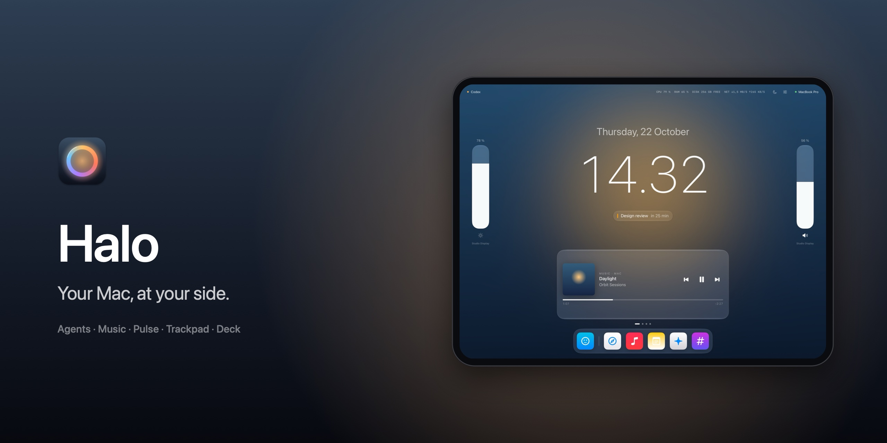
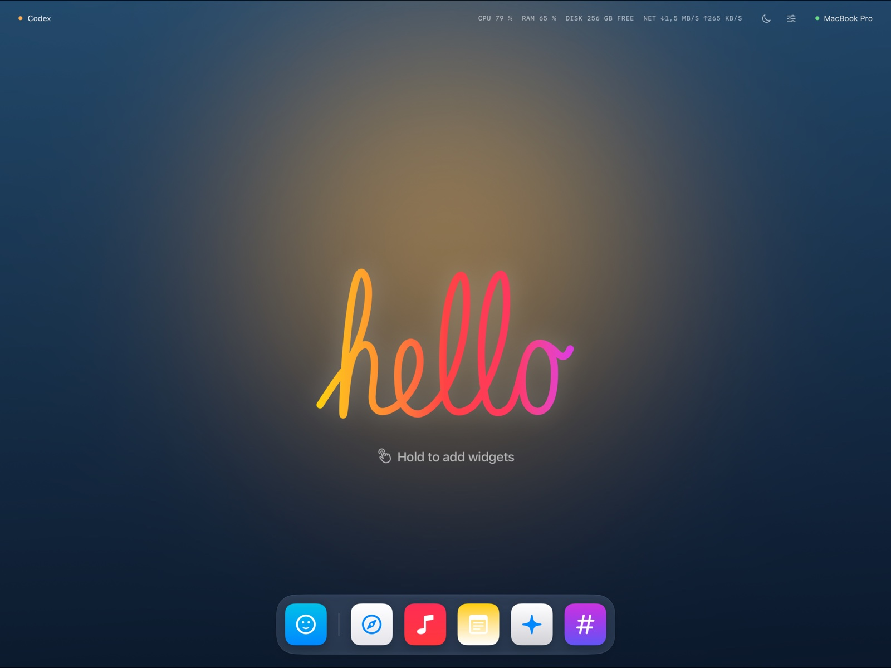
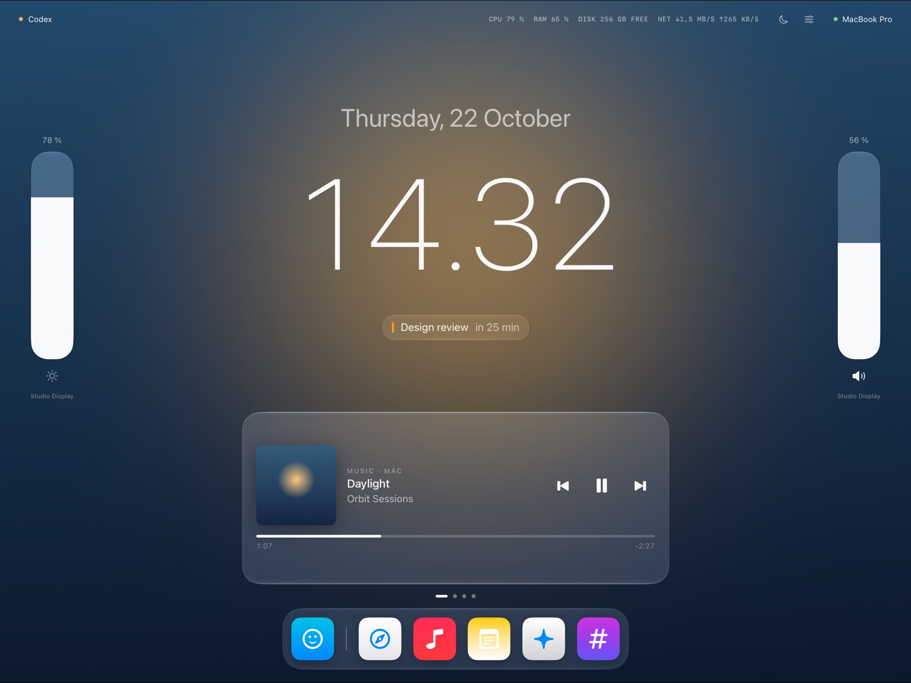
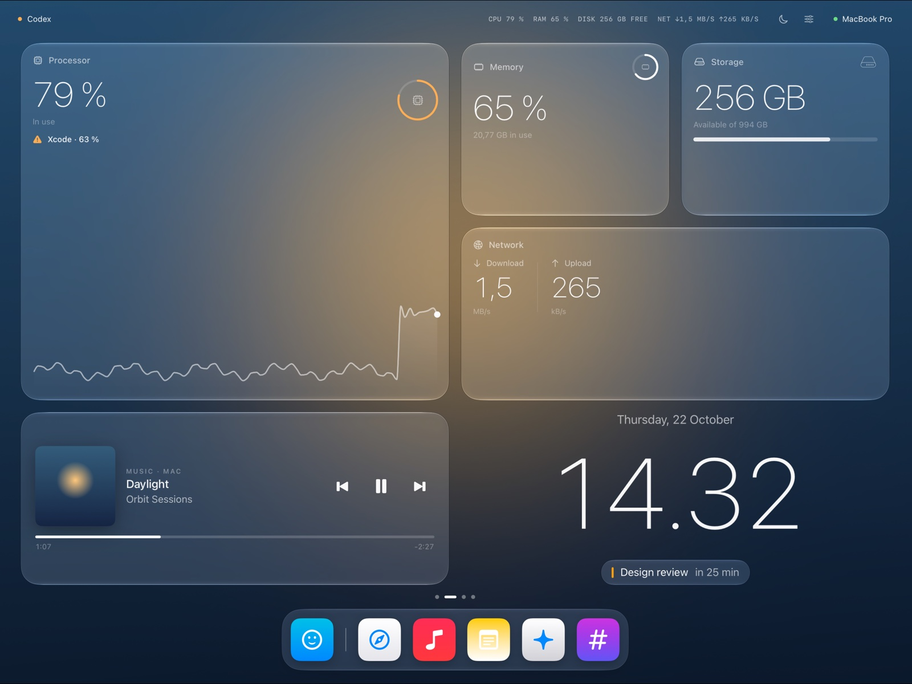
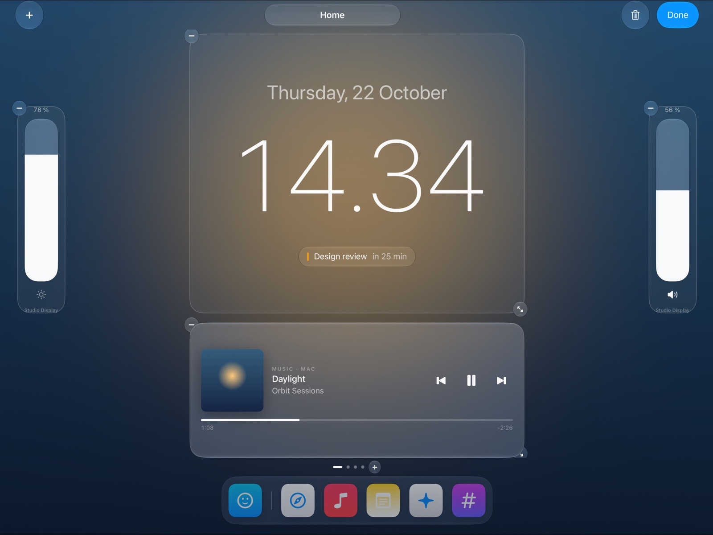
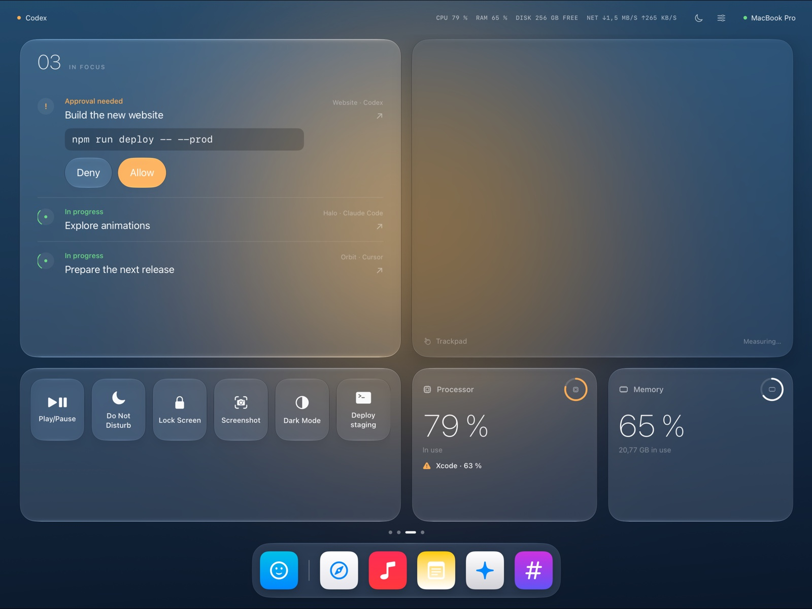
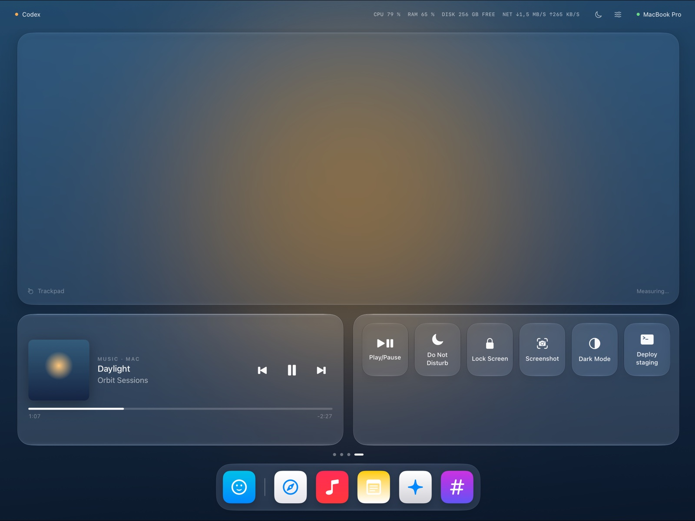
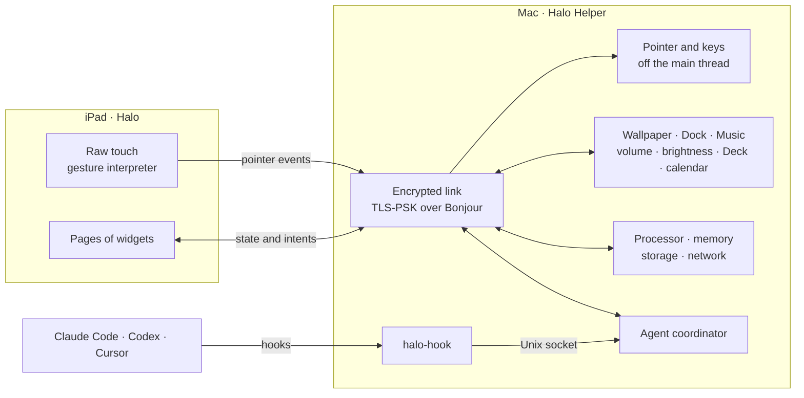
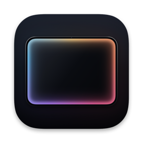

<div align="center">



<br>

### The iPad beside your Mac, brought to life.

Your agents, your music, your Mac's health and a trackpad,<br>
arranged on your iPad exactly the way you want them.

<br>

[](#get-halo)
[](#get-halo)
[](#how-it-works)
[](#privacy-and-security)
[](LICENSE)
[](https://github.com/Pallepadehat/Halo/actions/workflows/ci.yml)

**[Meet Halo](#meet-halo)** · **[Widgets](#widgets)** · **[Agents](#agents)** · **[Trackpad](#trackpad)** · **[Get Halo](#get-halo)** · **[Privacy](#privacy-and-security)** · **[How it works](#how-it-works)** · **[Contributing](#contributing)**

<br>

<a href="https://buymeacoffee.com/patrickjakobsen"></a>

</div>

<br>

## Meet Halo

Most desks have an iPad on them doing nothing. Halo turns it into a calm, always-on companion for your Mac: one glance tells you how your Mac is doing, what's playing, and whether an agent is waiting for you, all without leaving the window you're working in.

It starts as a blank page and a handwritten hello. Hold anywhere, and you build it yourself.

<table>
<tr>
<td width="50%"></td>
<td width="50%"></td>
</tr>
<tr>
<td valign="top"><b>Hello.</b> A fresh install is an empty page and a handwritten greeting. Hold to add your first widget.</td>
<td valign="top"><b>Home.</b> The time, what's next on your calendar, what's playing, and your Mac's brightness and volume, one swipe away.</td>
</tr>
</table>

**The backdrop is your Mac.** Halo blurs your Mac's own wallpaper into the background, so the iPad always looks like part of your desk. When music plays, the album artwork takes over and drifts slowly behind everything, like Apple Music's full-screen player.

**Your Dock, on your iPad.** The apps in your Mac's Dock sit in a Liquid Glass tray at the bottom of every page, with their real icons. Tap one and it opens on your Mac.

**It comes to you.** When an agent needs your approval, Halo brings forward the page that shows it. Swipe away and Halo leaves you be until something new happens.

<br>

## Widgets

Widgets come in sizes, like Apple's: **Small**, **Medium**, **Large** and **Extra Large**, plus **Slim** for a single slider. The gallery shows every one live, at the exact size it'll have on your iPad. Pick a size and add it.

<table>
<tr>
<td width="50%"></td>
<td width="50%"></td>
</tr>
<tr>
<td valign="top"><b>Your Mac, at a glance.</b> Processor, memory, storage and network, with a ten-minute trend. When something spikes, Halo names the app responsible.</td>
<td valign="top"><b>Make it yours.</b> Hold to edit. Drag to move, pull the corner to change size, add pages, and name them.</td>
</tr>
</table>

| Widget | Sizes | What it does |
| --- | --- | --- |
| **Clock** | S · M · L · XL | The time in SF at its thinnest, the date, and your next calendar event |
| **Now Playing** | S · M · L | Music on your Mac: artwork, track, play/pause and skip |
| **Brightness** | Slim | Every connected display at once. Apple displays use their backlight, others are dimmed in software |
| **Volume** | Slim | Your Mac's output volume. Tap the speaker to mute |
| **Processor** · **Memory** | S · M · L | How hard your Mac is working, with the app responsible when it spikes |
| **Storage** · **Network** | S · M · L | Space left, and download and upload right now |
| **Agents** | M · L · XL | Every Claude Code, Codex and Cursor session. Approve right there |
| **Trackpad** | M · L · XL | A large trackpad for your Mac, with gestures of your own |
| **Deck** | S · M · L | One-tap actions: lock screen, dark mode, screenshot, and every Shortcut on your Mac |

**Edit Widget.** Tap a Deck or a Trackpad in edit mode to set it up: choose and reorder the Deck's actions, or give a three- or four-finger tap any action you like.

<br>

## Agents



Coding agents work for minutes at a time, then stop and wait for you. Halo shows every session on your iPad, the ones that need you first, so you can keep working.

- **Approve or deny from the iPad.** When Claude Code or Codex asks permission to run something, the request appears with the exact command. Tap **Allow** or **Deny** and the agent carries on.
- **Bring it forward.** Tap a session and its terminal or editor comes to the front on your Mac.
- **Claude Code, Codex and Cursor.** Turn each on from Halo Helper's menu. Cursor has no permission hook, so it's shown read-only.
- **It never gets in the way.** If Halo Helper isn't running, your agents behave exactly as if Halo weren't installed. A request nobody answers in 90 seconds falls back to the agent's own prompt on your Mac.

<br>

## Trackpad



Any size, anywhere on any page. It reads raw touches the moment they land, with nothing waiting to work out what a gesture is, and plays them on your Mac off the main thread. The budget is **under 20 ms from finger to pointer**, and debug builds show the live latency right on the widget.

| Fingers | Gesture | On your Mac |
| --- | --- | --- |
| 1 | Move | The pointer moves, faster flicks go further |
| 1 | Tap · tap twice | Click · double-click |
| 1 | Hold, then move | Drag |
| 2 | Tap | Right-click |
| 2 | Move · flick | Scroll, with momentum that coasts and slows like a real trackpad |
| 2 | Pinch | Zoom in and out |
| 3 | Swipe | Switch spaces, Mission Control, App Exposé |
| 3 · 4 | Tap | Anything you choose: any Shortcut or Deck action |

<br>

## Get Halo

Halo is two apps: **Halo** on the iPad, which draws everything and senses touch, and **Halo Helper**, a small menu bar app on the Mac that does everything else. You need an iPad on **iPadOS 26**, a Mac on **macOS 26**, and both on the same network.

### On your Mac

Paste this into Terminal:

```sh
curl -fsSL https://raw.githubusercontent.com/Pallepadehat/Halo/main/install.sh | bash
```

It downloads the latest release, puts Halo Helper in your Applications folder (replacing an older copy) and opens it. From then on it keeps itself up to date: once a day it checks GitHub for a new version, and installs it when you say so. The install script is [short and readable](install.sh), if you'd like to check it first.

<details>
<summary><b>Or use the .dmg</b></summary>
<br>

Download **HaloHelper.dmg** from the [latest release](https://github.com/Pallepadehat/Halo/releases/latest), open it and drag Halo Helper into Applications.

</details>

### On your iPad

Halo for iPad isn't on the App Store yet. Build it from source with Xcode, as in [Build it yourself](#build-it-yourself) below, and run the **HaloPad** scheme on your iPad.

### Pair them

1. Click **◎** in your Mac's menu bar and choose **Pair iPad…**
2. Open Halo on your iPad and tap your Mac.
3. Check that both screens show the same six-digit code, and confirm on both.

That's it. From now on, your iPad finds your Mac by itself whenever they're on the same network.

<details>
<summary><b>Which permissions does Halo ask for, and why?</b></summary>
<br>

| Permission | Where | What for |
| --- | --- | --- |
| **Local Network** | iPad and Mac | Finding each other and staying connected |
| **Accessibility** | Mac | The trackpad: moving the pointer, clicking and scrolling |
| **Automation** | Mac, per app | Reading what Music is playing, and playing, pausing and skipping |
| **Calendars** | Mac | Your next event beside the clock |

Every permission is optional. Halo just does less without it.

</details>

### Build it yourself

You need **Xcode 26 or later** and [XcodeGen](https://github.com/yonaskolb/XcodeGen).

```sh
git clone https://github.com/Pallepadehat/Halo.git
cd Halo
brew install xcodegen
xcodegen generate
open Halo.xcodeproj
```

Run **HaloMac** for the Mac helper and **HaloPad** for the iPad. Or build the helper from the terminal with `./scripts/build.sh`.

> [!NOTE]
> The project ships with the maintainer's team ID and bundle IDs. To sign your own copy, change `DEVELOPMENT_TEAM` (and the bundle IDs, if you like) in `project.yml` and run `xcodegen generate`. Bonjour only works for signed builds, so pairing needs a real team. Debug builds of the helper install to `~/Applications`, because macOS only advertises Bonjour services for apps in a standard location.

<br>

## Privacy and security

Halo can move your pointer and approve your agents' commands, so it's built to deserve that.

- ✅ **Paired iPads only.** Pairing uses numeric comparison, as Bluetooth does: both screens show the same code and you confirm on both, so a device in the middle can't slip in.
- ✅ **Encrypted end to end.** Every connection after pairing uses TLS, keyed by a secret only your two devices share, with a fresh key exchange each time. Secrets live in the Keychain, on each device only.
- ✅ **Nothing leaves your network.** No account, no server, no analytics. The only internet traffic is a daily check of GitHub for a new version of the helper (a small file; nothing about you is sent).
- ✅ **Agents fail open.** If anything goes wrong, or the helper isn't running, your agents behave exactly as if Halo weren't installed.
- ✅ **Read-only where it should be.** Cursor has no permission hook, so Halo never answers on its behalf.

Found a way around any of this? Please report it privately: see [SECURITY.md](SECURITY.md).

<br>

## How it works



Everything that can be logic lives on the Mac, so the iPad stays thin and every widget works the same way. Shared code lives in one Swift package, `Packages/HaloKit`, as small modules that are each unit-tested:

```
Apps/
  HaloPad/      the iPad app: pages, widgets, edit mode, the trackpad surface
  HaloMac/      the menu bar helper: pairing, agents, desktop feed, updates
  HaloHook/     halo-hook, the tiny relay agent tools run for each hook
Packages/HaloKit/
  HaloCore        models shared by both apps
  HaloProtocol    what the iPad and the Mac say to each other
  HaloTransport   pairing, encryption, Bonjour, the Keychain
  HaloDashboard   pages and widgets on a grid, and every layout rule
  HaloTrackpad    touches in, pointer events out, momentum
  HaloInput       pointer events played on the Mac
  HaloAgents      agent adapters, sessions and approvals
  HaloHookBridge  halo-hook to helper, over a Unix socket
  HaloMetrics     the Mac's health, and what's eating it
  HaloDesktop     wallpaper, Dock, Music, volume, brightness, Deck, calendar
scripts/          build, icons, banner, disk image and release
```

The architecture, the design language and the rules that keep Halo fast and safe are written down in **[AGENTS.md](AGENTS.md)**.

<br>

## Contributing

New widgets, new Deck actions, other agent tools and polish are all very welcome. See **[CONTRIBUTING.md](CONTRIBUTING.md)**.

- The Xcode project is generated from `project.yml` with XcodeGen. Run `xcodegen generate` after adding files.
- Try any widget without a Mac: DEBUG builds of the iPad app take `-HaloDemo <page>`, plus `-HaloDemoEmpty`, `-HaloDemoEditing`, `-HaloDemoGallery` and `-HaloFrame 1366x1024`.
- The icon and the banner are drawn in code: `./scripts/make-icons.sh` and `./scripts/make-banner.sh`.

### Making a release

Releases of the helper are signed with a Developer ID certificate and notarized by Apple, so macOS opens them without warnings. Once, save your notarization login in the keychain (make an app-specific password at [account.apple.com](https://account.apple.com) → Sign-In and Security → App-Specific Passwords):

```sh
xcrun notarytool store-credentials halo-notary --apple-id <your Apple ID> --team-id <your team ID>
```

For each release, bump `MARKETING_VERSION` in `project.yml`, commit, and run:

```sh
./scripts/release.sh
```

It builds the helper, packs it into `HaloHelper.dmg`, has Apple notarize it, tags the commit and publishes a GitHub release with the disk image and Sparkle's `appcast.xml`. Run `./scripts/release.sh --without-notarizing` to sign with Developer ID only.

The appcast is signed with a Sparkle key in the maintainer's keychain, and its public half is `SUPublicEDKey` in `project.yml`. **Back it up**: without it, copies already out there can't update.

<br>

## Credits

- **[Sparkle](https://sparkle-project.org)** keeps the helper up to date (MIT License).
- **The handwritten hello** is from Michal's *AppleHello* SwiftUI sample, and follows Apple's own "hello" lettering. Its licence hasn't been confirmed: see `Apps/HaloPad/Sources/Dashboard/HelloShape.swift`.
- Inspired by **Orbit**, which first put a Mac companion on the iPad beside it.

## License

**[MIT](LICENSE)**. Third-party code keeps its own licence.

<div align="center">
<br>

<br>
<sub>Made by Patrick Jakobsen</sub>
</div>
